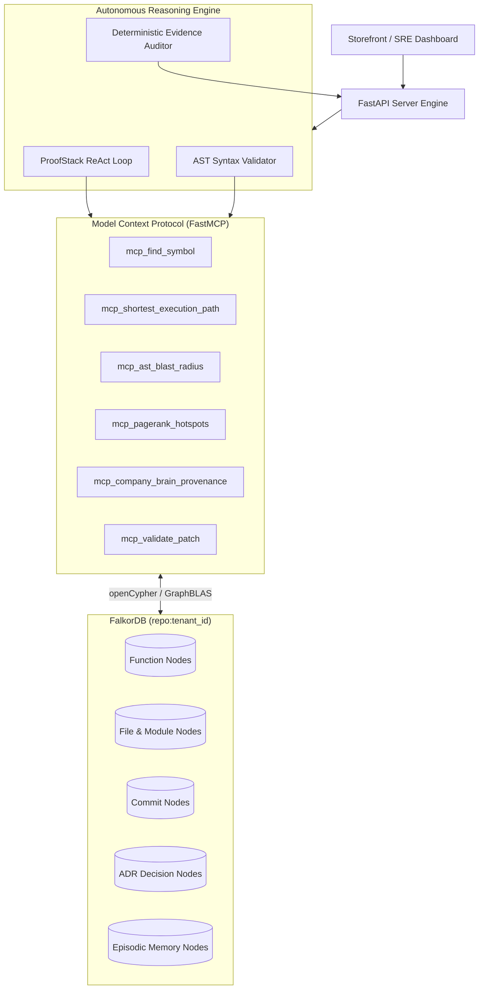

# ProofStack

### Graph-Grounded Incident Investigation and AST-Verified Remediation Engine

[](https://falkordb.com/)
[]()
[](https://fastapi.tiangolo.com)
[](https://react.dev)
[]()

---

## 1. Executive Summary

Traditional AI coding assistants treat software repositories as unstructured text files, relying on lexical grep searches that fail on complex call graphs and frequently hallucinate non-existent execution paths.

**ProofStack** addresses this vulnerability by using **FalkorDB** as the deterministic, load-bearing brain for software incident triage and code remediation. ProofStack parses source code into an Abstract Syntax Tree (AST) code graph, resolves static call relationships, and links code entities directly to Git commit histories and Architectural Decision Records (ADRs). 

During an operational incident, the autonomous agent executes openCypher traversals, computes upstream blast radiuses via GraphBLAS, identifies historical code provenance, and generates AST-verified unified diff patches with zero working-tree mutations until explicit human approval.

---

## 2. Architectural Pillars

| Capability | Mechanism | FalkorDB Implementation |
|---|---|---|
| **Multi-Hop Execution Pathfinding** | Traces real runtime execution chains between API entrypoints and failing symbols. | `MATCH p = shortestPath((src:Function)-[:CALLS*1..8]->(tgt:Function)) RETURN p` |
| **Upstream Blast Radius Analysis** | Determines all callers, background workers, and endpoints impacted by a failing function. | `MATCH (caller:Function)-[:CALLS*1..5]->(target:Function {name: $name}) RETURN count(DISTINCT caller)` |
| **GraphBLAS Centrality & Hotspots** | Identifies critical architectural bottlenecks and structural risk areas across the graph. | Native `algo.pageRank` computation over directed call graph edges. |
| **Company Brain & Provenance** | Traces code authorship, historic commit diffs, and governing architectural policies. | Traversals across `[:CHANGED]`, `[:AUTHORED_BY]`, and `[:GOVERNED_BY]` relationships. |
| **AST-Verified Remediation** | Synthesizes and tests code diffs in memory against Python syntax trees before presentation. | Verification pipeline (`ast.parse()`) combined with protected commit operations (`/api/patch/apply`). |
| **Auditable Evidence Registry** | Every claim in the incident report is paired with its exact openCypher query and source line. | Parameterized query logs with execution coordinates (`file:line`) and deterministic audit schema. |

---

## 3. System Architecture



---

## 4. Graph Data Model

Each repository ingested into ProofStack is isolated in its own multi-tenant graph namespace (`repo:<tenant_id>`).

### Node Types

- **Function**: Declared function or method, indexed by qualified symbol identity (`repo:lang:module:qualname`).
- **File**: Source file on disk, recording relative path, byte size, and language.
- **Module**: Logical module namespace within the software architecture.
- **Commit**: Version control snapshot with SHA, commit message, author name, author email, and timestamp.
- **ADR**: Architectural Decision Record or compliance policy governing code design (`[ADR-042]`, `[ADR-037]`).
- **Engineer**: Team contributor linked to commit changes and code ownership.
- **Finding**: Documented incident observation and verified remediation status.

### Relationship Types

- `(:Function)-[:CALLS]->(:Function)`: Static call site invocation verified by symbol resolution.
- `(:File)-[:DEFINES]->(:Function)`: File containment of function symbol.
- `(:Commit)-[:CHANGED]->(:File)`: Modifications introduced by version control commit.
- `(:Commit)-[:AUTHORED_BY]->(:Engineer)`: Attribution of commit changes to contributor.
- `(:Commit)-[:GOVERNED_BY]->(:ADR)`: Architectural policy explicitly referenced in commit record.
- `(:Finding)-[:ATTACHED_TO]->(:Function)`: Episodic memory linking incident analysis to symbol.

---

## 5. Live Demonstration Scenarios

ProofStack includes a modular fintech repository (`sample_fintech_repo`) pre-configured with realistic multi-service dependencies and production failure scenarios.

### Scenario A: Cascading 504 Timeout Under Peak Load

- **Incident Context**: Storefront checkout returns intermittent `504 Gateway Timeout` errors during high-throughput flash sales.
- **Target Function**: `decrypt_card_token` (`security/token_vault.py`)
- **Entrypoint**: `post_checkout_endpoint` (`checkout_router.py`)
- **Root Cause**: An exclusive distributed row lock is acquired in `database/ledger_store.py` before calling `decrypt_card_token`. Under peak load, token vault latency exceeds the strict 50ms gRPC timeout enforced by `ADR-042`. Because the call site lacks a `try...finally` unlock handler, the transaction lock remains unreleased, causing subsequent requests to block indefinitely and trigger 504 gateway timeouts.
- **Traversed Execution Path**:
  ```
  post_checkout_endpoint (checkout_router.py)
    --> process_payment_settlement (services/payment_gateway.py)
      --> acquire_transaction_lock (database/ledger_store.py)
        --> decrypt_card_token (security/token_vault.py)
  ```
- **Provenance**: Attributed to `Aarav Mehta` via commit `[ADR-042] Enforce strict 50ms gRPC timeout on decrypt_card_token for PCI SLA`.
- **Blast Radius**: 4 upstream callers across checkout, refund routing, and recurring subscription engines.
- **Remediation**: The generated AST-verified patch introduces jittered backoff, raises the timeout threshold to 200ms with a `DECRYPT_GRPC_TIMEOUT_MS` environment override, and guarantees safe lock release.

### Scenario B: Double-Entry Ledger Reconciliation Failure (500 Error)

- **Incident Context**: Cross-border international payouts fail during end-of-day settlement with an internal 500 error: `LedgerReconciliationError: Debit and Credit sums do not balance`.
- **Target Function**: `calculate_fx_spread` (`services/currency_service.py`)
- **Entrypoint**: `initiate_cross_border_payout` (`checkout_router.py`)
- **Root Cause**: `calculate_fx_spread` applies foreign exchange margins using binary floating-point multiplication (`amount * (1.0 + spread_bps / 10000.0)`). Floating-point inaccuracies generate fractional cent discrepancies (e.g., `104.99999999999999` vs `105.00`), violating double-entry ledger invariants enforced by `verify_double_entry_balance`.
- **Traversed Execution Path**:
  ```
  initiate_cross_border_payout (checkout_router.py)
    --> convert_and_settle_transfer (services/currency_service.py)
      --> calculate_fx_spread (services/currency_service.py)
        --> verify_double_entry_balance (services/ledger_service.py)
  ```
- **Provenance**: Traced to `Kabir Verma` via commit `[ADR-037] Implement dynamic FX spread calculation for cross-border checkout`.
- **Remediation**: The remediation patch migrates arithmetic to Python `decimal.Decimal` with explicit `ROUND_HALF_UP` quantization, ensuring zero-drift balance equality.

---

## 6. FastMCP Tool Reference

ProofStack exposes specialized FastMCP tools to enable structured interaction with FalkorDB:

| Tool Name | Parameters | Output Description |
|---|---|---|
| `mcp_find_symbol` | `query`, `tenant_id` | Fuzzy and exact lookup of function and class symbols across repository AST. |
| `mcp_shortest_execution_path` | `entrypoint_fn`, `target_fn`, `tenant_id` | Multi-hop shortest call chain connecting source and target functions. |
| `mcp_ast_blast_radius` | `function_name`, `tenant_id`, `max_depth` | Set of all upstream and downstream transitive callers within N hops. |
| `mcp_pagerank_hotspots` | `tenant_id`, `top_k` | GraphBLAS PageRank structural centrality scores for all repository symbols. |
| `mcp_company_brain_provenance` | `function_name`, `tenant_id` | Historical Git commit author attribution and governing ADR references. |
| `mcp_find_changes_on_path` | `entrypoint_fn`, `target_fn`, `tenant_id` | Commits that modified files along an investigated execution path. |
| `mcp_explore_graph_neighborhood` | `symbol_or_entity`, `depth`, `tenant_id` | Immediate 1-hop and 2-hop graph neighborhood inspection. |
| `mcp_inspect_function` | `function_name`, `tenant_id` | Complete signature, docstring, source slice, and caller summary. |
| `mcp_validate_patch` | `file_path`, `patch_diff`, `tenant_id` | Simulated in-memory patch application and Python AST syntax verification. |
| `mcp_write_episodic_memory` | `function_name`, `summary`, `remediation` | Persistent storage of verified incident findings into FalkorDB. |

---

## 7. Installation and Local Setup

### Prerequisites

- Docker (running locally on port 6379)
- Python 3.10+
- Node.js 18+ and npm

### 1. Start FalkorDB

```bash
docker run -p 6379:6379 -it --rm falkordb/falkordb:latest
```

### 2. Configure Backend Environment

Create a `.env` file inside the `backend/` directory:

```env
# Optional Azure OpenAI / OpenAI credentials
AZURE_OPENAI_API_KEY=your_key_here
AZURE_OPENAI_ENDPOINT=https://your-resource.openai.azure.com/
AZURE_OPENAI_API_VERSION=2024-10-21
AZURE_OPENAI_DEPLOYMENT=gpt-5

# FalkorDB Instance Configuration
FALKORDB_HOST=localhost
FALKORDB_PORT=6379
FALKORDB_GRAPH=repo:sample-fintech
```

### 3. Initialize Python Environment and Ingest Repository

```bash
# Set up Python virtual environment
python3 -m venv backend/venv
source backend/venv/bin/activate
pip install -r backend/requirements.txt

# Build sample fintech repository with commit lineage
python backend/create_sample_repo.py

# Ingest codebase AST and Git history into FalkorDB
python backend/ingest_repo.py ./sample_fintech_repo sample-fintech
```

### 4. Launch Backend API Server

```bash
uvicorn server:app --reload --port 8000
```

### 5. Launch Frontend Dashboard

```bash
cd frontend
npm install
npm run dev
```

The ProofStack dashboard will be accessible at **http://localhost:5173**.

---

## 8. API Endpoints

| Method | Endpoint | Description |
|---|---|---|
| `GET` | `/api/llm/status` | Returns active LLM engine status and FalkorDB connectivity. |
| `GET` | `/api/tenants` | Lists all indexed repository graph namespaces (`repo:*`). |
| `GET` | `/api/graph/{tenant_id}` | Retrieves full graph topology for 2D force-directed rendering. |
| `GET` | `/api/agent/investigate/stream` | Server-Sent Events (SSE) stream for real-time ReAct loop execution. |
| `POST` | `/api/investigation/report` | Generates deterministic, auditable Markdown incident report. |
| `POST` | `/api/patch/generate` | Generates on-demand unified diff patch with AST syntax validation. |
| `POST` | `/api/patch/apply` | Commits verified patch to Git working tree and records resolved finding. |
| `GET` | `/api/repositories/{tenant_id}/tree` | Directory tree explorer for the indexed repository. |
| `GET` | `/api/repositories/{tenant_id}/files` | File content reader with syntax highlighting support. |
| `GET` | `/api/repositories/{tenant_id}/commits` | Commit history and author log viewer. |

---

## 9. Security and Safety Guarantees

1. **Zero Unattended Repository Mutations**: ProofStack does not alter working tree files during investigation. Patch generation executes in memory against extracted AST representations.
2. **Deterministic Syntax Verification**: Generated diffs are parsed with `ast.parse()` prior to display. Diff hunks with syntax errors or misaligned line numbers are flagged and rejected.
3. **Protected Commit Operations**: Application of code changes to version control requires explicit human approval via the `/api/patch/apply` endpoint, creating an auditable Git commit record.
4. **Tenant Namespace Isolation**: Multi-tenant repository graphs are partitioned by strict `repo:<tenant_id>` prefixes, preventing cross-repository data pollution.

---

## 10. License

ProofStack is licensed under the Apache License 2.0.
